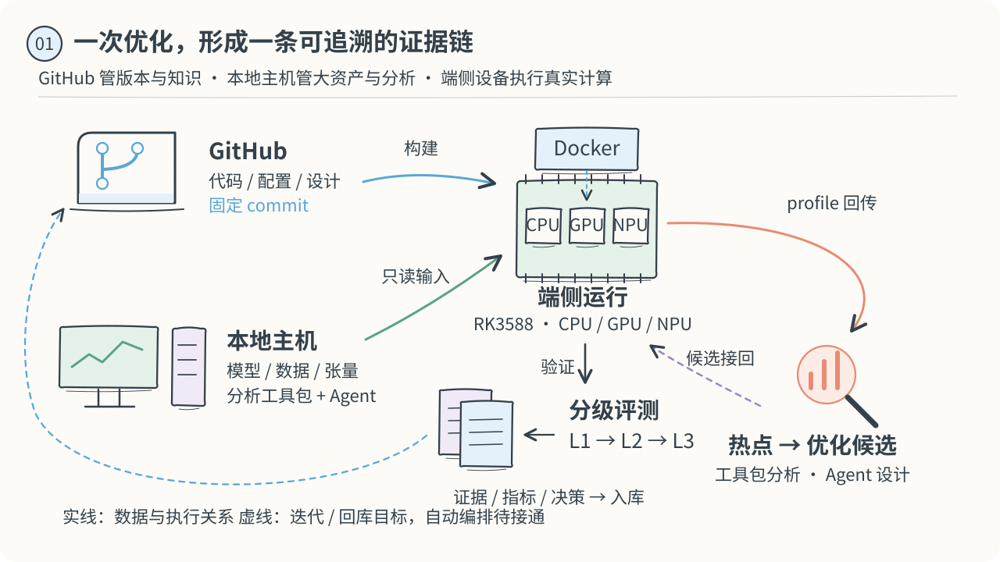
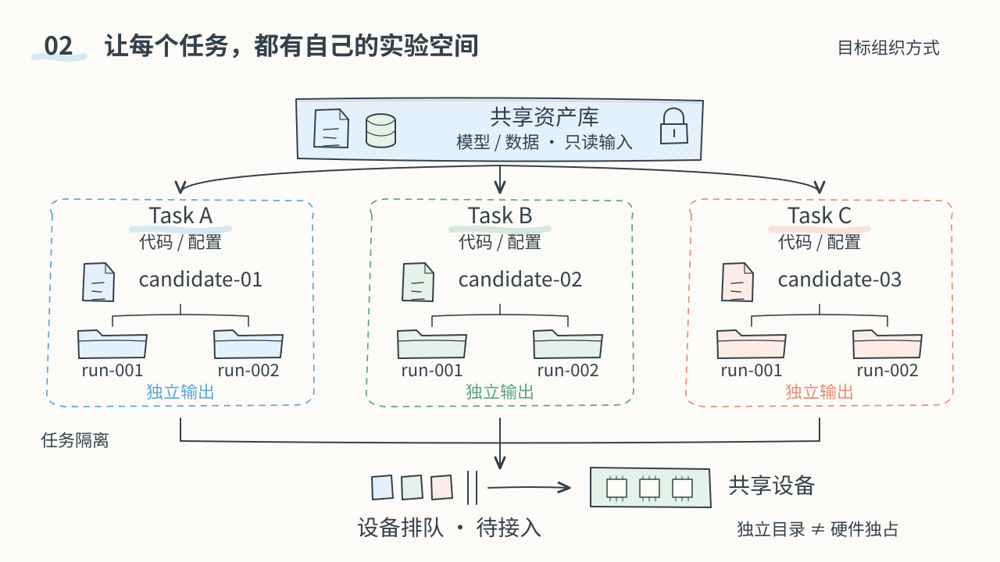
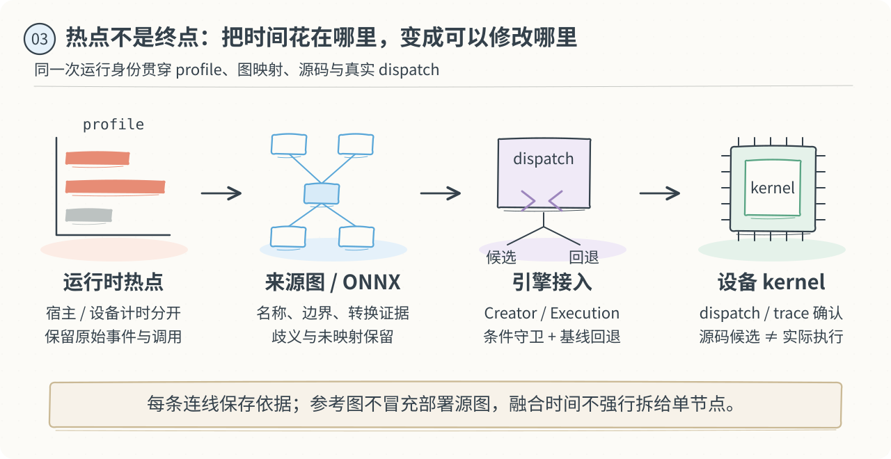
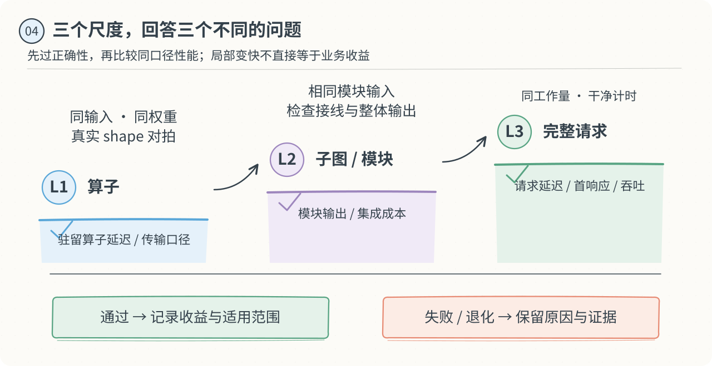
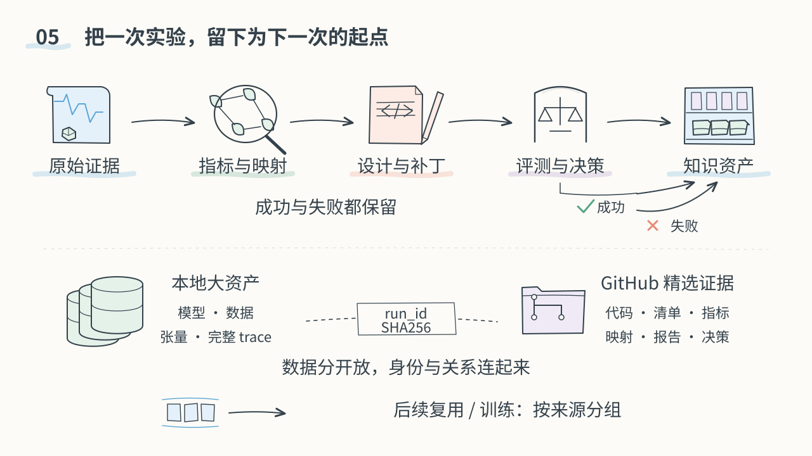

<div align="center">

# kernel_bench_opt

### 从端侧计算任务，到可以复用的优化知识

**任务隔离 · 真实 Profiling · Agent 优化 · 多级 Benchmark · 资产归档**

[单文件图文版](README.html) · [看全流程](#一张图看懂整套协作) · [看任务沙箱](#每个任务都有自己的实验工作区) · [看资产管理](#让一次实验留下可复用的资产) · [开始使用](#从这里开始)

</div>

这个仓库组织一套端侧推理优化工作方式：为每个待计算、待分析或待优化的任务建立独立工作区，在真实设备上采集证据，让分析工具包与 Agent 协作定位瓶颈、提出候选，再通过分级评测决定是否保留。**一轮结束后，代码、数据身份、性能结果、设计依据和失败经验都能沿着同一条证据链找回来。**

GitHub 保存代码与精选知识，本地主机保存大资产并承担分析，端侧设备执行真实计算。本分支 `Qwen2.5-Omni-3B_VCB-Bench` 用于该模型与数据协议下的任务；相同方法可用于其他模型、算子、子图和设备，具体后端与测试入口按项目适配。

> **目前可以使用什么？** 已有候选实现、采集与分析脚本、分级评测入口、历史证据和容器配方。下面展示的是完整目标 SOP；本地 Task / Candidate / Run 初始化、资产清单、精选归档和索引脚本已补齐，当前仅代码交付、未运行验收；设备排队、持续回传、Agent 自动循环与自动回库仍需接通。容器配方尚未在新板构建验收。

## 一张图看懂整套协作



| 在哪里 | 主要职责 | 一轮任务留下什么 |
|---|---|---|
| **GitHub · 版本与知识** | 固定代码版本，管理候选、配置、设计和精选证据 | commit、Dockerfile、候选身份、指标、映射、决策 |
| **本地主机 · 资产与分析** | 保存模型、全量数据集和张量；运行工具包与 Agent | 完整 trace、分析工作区、热点表、来源关系、候选补丁 |
| **端侧设备 · 真实计算** | 容器挂载本次资产，使用实际 CPU / GPU / NPU 执行 | 输出、设备 profile、运行日志、温度/频率、逐次耗时 |

数据通过**身份与记录**衔接：代码用 commit，模型与输入用哈希，容器用镜像 ID，实验用 run ID。图中的双向迭代是“候选回到设备验证，证据回到主机与仓库”，性能结论始终来自实际执行的设备。

### 一轮任务的七个步骤

| 步骤 | 做什么 | 交接物 |
|---|---|---|
| **① 定义任务** | 明确目标、输入范围、精度、不变量、样本和时间预算 | 任务说明、模型/数据身份、基线版本 |
| **② 准备工作区** | 固定代码与环境，挂载只读资产，分配独立输出目录 | 配置、镜像/引擎/驱动身份、实际命令 |
| **③ 采集证据** | 用代表性请求采集 profile；正式性能测量另开运行 | 原始事件、请求输出、环境遥测、完成状态 |
| **④ 定位与溯源** | 分析热点，连接来源图、执行器与设备实现 | 热点排名、映射依据、未确认项、优化入口 |
| **⑤ 实现候选** | Agent 围绕一个可验证假设修改，保留原实现与回退条件 | 设计说明、补丁、父候选、适用 shape |
| **⑥ 分级评测** | 从算子、模块到完整请求，逐级核对正确性与性能 | 原始 A/B、正确性结果、收益与退化 |
| **⑦ 归档与决策** | 保存成功与失败，决定保留、回退或继续补证据 | 候选状态、报告摘要、资产清单、下一步方向 |

当前工具包读取设备生成的稳定文件；可以在请求完成后回传分析。要做到持续、低延迟的 profile 分析，还需按请求封闭分片、写入完成标志并接入回传触发器。详细接口见 [工作流程说明](docs/SOP.md)。

## 每个任务都有自己的实验工作区



这里的“沙箱式管理”指 **任务有边界，资产有归属，结果不串用，实验可以回放**。它从目录、配置和记录开始：任务 A 的候选、缓存、日志与结果，不能悄悄覆盖任务 B 的基线。

按四层身份组织；本地管理入口为 [`scripts/sandbox.py`](scripts/sandbox.py)，覆盖任务、候选、Run、资产登记与索引，详细命令见 [本地沙箱管理](docs/SANDBOX.md)。它只管理文件与记录，不执行实验。

| 层级 | 回答的问题 | 例子 |
|---|---|---|
| **模型 / 数据协议分支** | 正在研究哪套模型与工作负载？ | `Qwen2.5-Omni-3B_VCB-Bench` |
| **Task · 任务** | 这次要解决什么计算或分析问题？ | 降低某子图延迟、扩大 shape 覆盖、比较设备后端 |
| **Candidate · 候选** | 相对于哪个父实现，具体改变了什么？ | `baseline → tile4 → tail-shape` |
| **Run · 一次运行** | 在哪台设备、什么环境和输入下获得了这份结果？ | 同一候选在板 A 裸机、板 B 容器上分别记录 |

<details>
<summary><strong>展开：单任务工作区，以及已有代码如何支持隔离</strong></summary>

下面是本地管理脚本对应的目录组织，默认位于 Git 忽略的 `.sandbox/`。归档文件另外存入 `archives/<task-id>/<run-id>/`，`index.json` 是可重建的查询缓存。

```text
tasks/<task-id>/
├── task.json                  目标、模型、数据集、分支、标签
├── assets.json                外置资产引用与身份
├── baseline/                  冻结的基线身份与配置
├── candidates/<candidate-id>/
│   ├── candidate.json         父候选、代码身份与假设
│   ├── design.md              变更、不变量、证据与决策
│   └── patch/                 可审阅的实现差异
└── runs/<run-id>/
    ├── run.json               本次候选、输入快照、状态和结果
    ├── raw/                   原始profile、输出、遥测
    ├── analysis/              热点、来源映射、报告
    ├── benchmark/             逐次耗时与正确性结果
    └── artifacts/             其他显式选择的任务产物
```

现有容器启动器将 `/assets` 和 SDK/驱动库只读挂载，`/work` 用于独立构建与输出；新构建会拒绝覆盖已经存在的 `source`、`build`。每次启动保存镜像 ID 和实际参数。主机分析则归入工具包自己的 `runs/<时间-任务>/`，发布副本保留来源身份。

容器共享板上内核与硬件，独立目录不等于 GPU/NPU 独占，也不会消除温度、频率和其他负载干扰。当前没有设备调度器；未来需要设备锁与排队，让共享设备的性能任务串行占用。这里不把容器描述为已经验收的多租户安全沙箱。

</details>

## 从热点，走到可以修改的实现



工具包的价值在于把“这里耗时多”变成一份可以交给实现者的定位结果。Agent 接到的应是 **热点证据 + 数学/张量合同 + 源码入口 + 适用范围**，然后提出可以通过实验验证的优化方案。

- **先分清时间。** 宿主 callback、设备 kernel、传输与请求墙钟属于不同计时域；重叠或嵌套区间不能直接相加。
- **再建立来源关系。** 对齐节点名、张量边界、shape、转换记录与实际版本；缺少证据时保留 `candidate / ambiguous / unmapped`。
- **最后定位接入点。** 找到 Creator、Execution、dispatch 或公开扩展接口，明确候选何时启用、何时走原实现；实际调用仍需 dispatch 或 trace 证据。

每轮设计记录四件事：**观察到了什么 → 为什么这样改 → 必须保持什么 → 怎样判断结果**。保存可审阅的设计依据与实验决策，让后续任务能够复用结论，也能理解某条路线为何失败。

[主机分析工具包](appendices/performance-analysis-toolkit/README.md) · [来源合同与精度边界](docs/OPERATOR.md) · [设计模板](experiments/templates/design.template.md)

## 用三级评测，把局部改进接回真实任务



| 层级 | 核心问题 | 必须记录 |
|---|---|---|
| **L1 · 算子** | 相同真实输入与部署权重下，新实现是否正确、更快？ | shape、layout、精度、数值误差、预热、逐次耗时、是否含传输 |
| **L2 · 子图 / 模块** | 接入引擎后，边界、同步、状态与整个模块输出是否正确？ | 模块输入输出、候选命中/回退、集成成本、计时边界 |
| **L3 · 完整请求** | 相同工作量下，业务延迟、首响应或吞吐是否真的改善？ | 完整输出/质量、请求耗时、配置、配对顺序、环境与波动 |

**正确性是进入性能比较的前提。** 固定输入、部署权重、计算精度和计时口径，保留全部正式观测。诊断 profiling 与干净性能测量分开；换设备、镜像、驱动或精度时，创建新的 run 并重新建立可比基线。

“正确且更快”“正确但退化”“数值失败”“构建失败”“证据不足”“未运行”分别记录。失败候选同样有价值：它能说明某个前提不成立、哪里需要同步，或哪些 shape 不适合当前变换。

## 让一次实验留下可复用的资产



归档的基本单位是一份**能够找回输入、实现、环境、测量与结论的运行记录**。报告是阅读入口，原始记录与来源关系提供复查依据；只保存一个最快数字，无法支持后续迁移、归因或训练数据整理。

### 什么放在哪里

| 资产 | 主要保存位置 | GitHub 保存的连接信息 |
|---|---|---|
| 模型、完整数据集、真实输入/权重张量 | 本地主机资产库；运行前成为端侧可见目录 | 资产 ID、来源/许可、版本、大小、SHA256、相对路径 |
| 完整 trace、波形、大型中间输出 | 本地任务/工具包归档 | 文件身份、关联 run、必要的小片段与摘要 |
| 候选 kernel、引擎接入、配置、镜像配方 | GitHub | 实现代码、父候选、commit、构建条件、回退规则 |
| 逐次 benchmark、正确性、热点与映射 | 小型文本入 Git，大型原件留本地 | JSON/JSONL/CSV、单位、计时域、原始文件引用 |
| 分析报告与设计经验 | 摘要、图和设计记录入 Git；完整 HTML 按项目外部归档 | 结论、证据链接、适用范围、外部报告引用、后续方向 |

本地主机大资产管理与同步服务暂不配置。Docker 的挂载源必须位于 **daemon 所在设备可访问的目录**；台式机路径需要先同步或共享给端侧。此前的大文件 Release 继续保留，今后的默认流程使用本地资产引用。

### 一份结果怎样与其他资产连起来

```text
Task（目标、模型/数据协议）
  └─ Candidate（父候选、代码commit、设计）
       └─ Run（设备、镜像、引擎/驱动、输入、命令）
            ├─ Profile → 热点 → 图映射 → 源码证据
            ├─ Benchmark → 正确性 → 性能与波动
            └─ Decision → 保留/回退/待补证据 → 下一轮候选

大资产：asset_id + SHA256 + 存储引用
小证据：run_id + 文件哈希 + 来源记录
```

本地脚本按 `run-init → run-finish → archive-run` 管理生命周期：初始化时冻结候选和资产身份，终态之后按显式文件清单归档，保存 SHA256，已有归档不覆盖。`index-rebuild` 可从记录重建任务、候选、Run、资产与归档索引；`list` 和 `show` 提供查询。

每次发布选择该任务相关的文件，保留来源清单；同一份日志生成的 CSV、摘要和报告是不同视图，不是新的独立实验。后来换一台设备复用候选时，保留原 run，新建运行记录，便于比较环境影响。

### 为后续检索和训练做准备

可复用的经验单元包含：**问题与环境、热点证据、候选变换、正确性结果、性能变化、接受/拒绝原因、适用边界**。既保留有效候选，也保留失败尝试和修正后的判断。

未来整理训练数据时，应按请求、capture 或工作负载来源分组。同一输入的多次 A/B、同一 trace 的多份报告、同一候选的派生记录共享来源组，避免把它们拆成互相泄漏的训练/评测样本。实际测量、结构候选、推断和未运行计划也要保留不同标签。

[运行记录模板](experiments/templates/run.template.json) · [历史数据来源清单](reports/historical/manifest.json) · [资产来源与许可](docs/ASSETS.md)

## 一个简短例子：这套流程怎样落到算子上

已有 BigVGAN ConvTranspose 实验走过了这条路径：**真实请求的热点 → 参考 ONNX 与 MNN 执行器定位 → 捕获三种真实 shape 和当前部署权重 → tile4 候选 → MNN 接入 → 分级对拍与完整请求 A/B → 成功、失败和来源记录归档。**

历史 L1 中位速度比为 **12.11–13.38×**；独立 PreDiT 同步构建中的一个样本、三对完整请求中位延迟为 **94.061 → 91.055 秒（降低 3.20%）**。这些数字只代表原板裸机及该工作负载；异步构建曾在波形检查失败，相关记录同样保留。它说明了为何需要多级评测，不能把局部算子加速直接当作业务收益。

[候选与设计](experiments/bigvgan-convtranspose-tile4/design.md) · [逐次 benchmark](benchmarks/history/20261106-bigvgan-convtranspose/README.md) · [热点片段](reports/20261106-bigvgan-convtranspose/README.md) · [历史 profile / 映射 / VCB 结果](reports/historical/README.md)

后续还保存了 [随机 10 条组合路径 A/B](reports/20261109-omni-combined-random10/README.md)：将既有 RKNN 音频前缀与 tile4 同时启用，与原 MNN/OpenCL 音频编码器和旧 ConvTranspose 比较。**9 对有效、其中 1 对严格同输出，8 对输出变化，第 10 对编码失败；组合的输出保持验收未通过。** 有效 9 对累计耗时降低 8.25%，仅为系统路径描述。这类负例同样进入 Task → Candidate → Run 证据链，供下一轮检查音频边界与数值路径。

[全部历史运行索引](benchmarks/history/README.md) · [组合候选与决策](experiments/rknn-prefix-bigvgan-tile4/design.md) · [逐请求证据与离线复算](benchmarks/history/20261109-omni-combined-random10/README.md) · [外置资产清单](assets/runs/20261109-112115-omni-combined-e2e-random10.json)

## 从这里开始

```bash
git clone --branch Qwen2.5-Omni-3B_VCB-Bench \
  https://github.com/shunwendongan/kernel_bench_opt.git
cd kernel_bench_opt
```

| 你现在要做什么 | 阅读 / 使用入口 |
|---|---|
| 初始化任务、登记资产、归档与查询 | [本地管理指南](docs/SANDBOX.md) · [CLI](scripts/sandbox.py) · [配置](configs/sandbox.default.json) |
| 了解各阶段的输入、输出与交接 | [工作流程说明](docs/SOP.md) |
| 准备端侧容器和本地资产挂载 | [容器指南](docs/CONTAINERS.md) · [Dockerfile](docker/Dockerfile.rk3588) · [启动器](docker/run_rk3588.py) |
| 使用已有候选或做新候选 | [候选身份](experiments/bigvgan-convtranspose-tile4/candidate.json) · [设计模板](experiments/templates/design.template.md) |
| 采集、分析、理解来源关系 | [Mac / Windows 工具包与 Skill](appendices/performance-analysis-toolkit/README.md) · [来源合同](docs/OPERATOR.md) |
| 查看分层结果或复用记录格式 | [三级复现入口](docs/REPRODUCE.md) · [历史 benchmark 索引](benchmarks/history/README.md) · [run 模板](experiments/templates/run.template.json) |
| 核对依赖与实际完成状态 | [依赖](docs/DEPENDENCIES.md) · [项目状态](docs/STATUS.md) · [原生构建](docs/BUILD.md) |

<details>
<summary><strong>仅阅读历史数据：离线复算统计，不运行模型</strong></summary>

```bash
python3 tools/analysis/analyze_results.py \
  --bench-root benchmarks/history/20261106-bigvgan-convtranspose/bench \
  --e2e benchmarks/history/20261106-bigvgan-convtranspose/e2e/paired_sync_20261106 \
  --out runs/history-reanalysis
```

这只是对已入库日志进行统计与协议审查，不能代替新设备验证，也不会重新检查外置波形字节。VCB 历史任务从各类别随机抽取50条，按停止指令实际完成29条；未完成样本的状态保留。

</details>

### 仓库导航

```text
kernels/ + src/mnn/            算子实现、引擎接入与回退
experiments/<candidate-id>/    候选身份、设计与下一步
experiments/templates/         后续实验与设计模板
benchmarks/history/<run-id>/   逐次记录、正确性、统计和失败案例
reports/                      profile片段、映射、历史分析数据与索引
docker/ + configs/            运行环境、挂载入口与配置
scripts/ + tools/             构建、采集、评测、离线分析
tools/sandbox/                本地任务、资产、归档和索引管理
docs/images/                  本页可编辑手绘风格SVG
assets/                       资产清单与来源；大型文件外置
```

### 已有组件与下一步接线

| 环节 | 当前状态 |
|---|---|
| 候选源码、MNN 接入、采集与分析、分级评测 | **已有组件与原板历史证据** |
| 候选/run身份、记录模板、来源清单、发布目录 | **已有文件与组织规范** |
| arm64 Docker 配方、只读资产挂载、独立工作目录 | **已准备代码与配置，镜像/新板运行待验收** |
| 本地 Task / Candidate / Run、资产登记、精选封存、索引查询 | **已补齐代码与配置，流程测试未运行** |
| 跨机资产服务、自动选择发布内容与全局检索 | **后续管理能力** |
| profile 分片回传、设备锁/排队、Agent 自动迭代 | **待接通自动编排** |
| 精选证据自动回库、面向训练的数据集整理 | **待建立发布与数据治理流程** |

手绘图展示目标工作方式；它们是可编辑 SVG，不依赖外部图片服务。另提供 [README.html 单文件版](README.html)，五张图和样式全部内嵌，下载后无需携带图片目录。两份历史 HTML 仅用于理解既有实验，未随本页重新发布。代码遵循 [Apache-2.0](LICENSE)，模型、数据与厂商依赖保留各自 [来源和许可](docs/THIRD_PARTY.md)。
