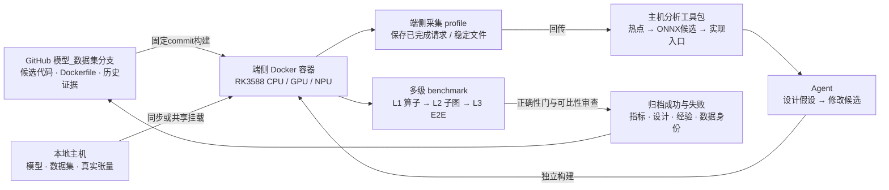

# kernel_bench_opt · 端侧算子优化与评测

把一次优化沉淀为 **候选代码 + 多级 benchmark + profile/映射证据 + 可复用经验**。本分支 `Qwen2.5-Omni-3B_VCB-Bench` 以 RK3588 上的 BigVGAN ConvTranspose 为首个案例，目标是逐步接通 agent 驱动的评测与优化循环。

**GitHub 管代码与知识，本地主机管大资产，端侧容器执行真实测试。** 模型、全量数据集和大张量通过端侧可见的本地目录挂载；Git 保存资产身份、必要的小型记录和结论。

## 工作流程



这张图是目标 SOP。已有采集器、离线分析、候选实现和分级评测入口；**连续流式profile、跨机器自动调度、agent自动迭代和自动回传提交尚未接通**。Docker配方已加入，本次未在新板构建或运行。操作细节见 [SOP](docs/SOP.md)。

## 已沉淀的第一个候选

**BigVGAN 第一个 ConvTranspose：tile4 复用同stride相位的权重载入，保持部署权重与FP16累加次序。** DiT独立保持FP32；未匹配的节点/shape继续走原kernel。

| 层级 | 已有证据 | 历史结果 |
|---|---|---|
| L1 · 单算子 | 真实T52/120/136；各15对A/B；位级一致 | 旧/新中位数 **12.11× / 13.20× / 13.38×**，仅驻留buffer算子区间 |
| L2 · BigVGAN集成 | 同mel的输入、目标输出、完整波形，共9项比较 | 全部位级一致；未声称独立干净子图总延迟 |
| L3 · 完整请求 | 独立PreDiT同步构建；同一样本3对A/B | **94.061 → 91.055秒，降低3.20%**；8次暖机/测量波形一致 |

这些是原板裸机历史结果，不能替代新板/容器验收。默认异步构建曾在波形门失败，0正式对；同步成功属于另一个构建，旧/新两侧均使用同步设置。小样本不报告稳定p95或统计显著性。

[候选源码](kernels/bigvgan_deconv_s5_tiled.cl) · [设计与下一步](experiments/bigvgan-convtranspose-tile4/design.md) · [候选身份](experiments/bigvgan-convtranspose-tile4/candidate.json) · [热点分析与profile片段](reports/20261106-bigvgan-convtranspose/README.md) · [原始评测证据](benchmarks/history/20261106-bigvgan-convtranspose/README.md) · [完整状态](docs/STATUS.md)

另已整理 [历史profile、ONNX映射与VCB逐请求数据](reports/historical/README.md)。VCB原计划随机50条，按停止指令实际完成29条；历史HTML报告与独立优化SOP由外部保存，不随本分支上传。

## 从哪里开始

```bash
git clone --branch Qwen2.5-Omni-3B_VCB-Bench \
  https://github.com/shunwendongan/kernel_bench_opt.git
cd kernel_bench_opt

# 仅复算已经入库的历史统计，不运行模型，也不下载大文件。
python3 tools/analysis/analyze_results.py \
  --bench-root benchmarks/history/20261106-bigvgan-convtranspose/bench \
  --e2e benchmarks/history/20261106-bigvgan-convtranspose/e2e/paired_sync_20261106 \
  --out runs/history-reanalysis
```

准备在新板测试时，先按 [容器指南](docs/CONTAINERS.md) 构建Linux/arm64环境，挂载资产和匹配固件的GPU/NPU依赖，再按 [多级复现](docs/REPRODUCE.md) 逐级验收。也保留 [原生构建](docs/BUILD.md) 路径。容器不自带板载内核驱动；台式机资产必须先变成端侧可见的目录。

## 每轮留下什么

| 位置 | 内容 |
|---|---|
| `kernels/`、`src/mnn/` | 候选实现、注册/dispatch入口、基线回退 |
| `experiments/<candidate-id>/` | 父候选、设计假设、源文件身份、不变量、优化方向 |
| `benchmarks/history/<run-id>/` | 原始小型JSONL/CSV、正确性记录、分层指标、失败案例、manifest |
| `reports/<run-id>/` | 主机分析报告、热点profile片段、来源映射与源码证据 |
| `experiments/templates/` | 后续run与设计模板，便于检索和构造训练数据 |
| `docker/`、`tools/` | 环境配方、端侧启动器、采集/评测/分析脚本 |
| 本地主机 / 端侧资产目录 | 大型模型、全量数据集、大张量、完整trace与缓存；Git只引用身份 |

每个结果绑定 **代码commit、镜像/引擎/驱动、模型与输入哈希、shape/精度、计时域、正确性门和原始记录**。失败与未运行如实保留；同一请求的重复测量、同一capture的变体应按来源分组，不能拆成独立训练/测试样本。规范见 [SOP与数据沉淀](docs/SOP.md)。

## 工具与既有资产

- [Mac / Windows 性能分析工具包公共附录](appendices/performance-analysis-toolkit/README.md)：下载、使用说明和Codex Skill说明。
- [此前发布的模型/数据/capture资产](docs/ASSETS.md)：历史Release保留；今后的默认流程从本地资产挂载，本次没有新增大文件上传。
- [算子与ONNX来源合同](docs/OPERATOR.md) · [同步候选](docs/SYNC_VARIANT.md) · [依赖](docs/DEPENDENCIES.md)。

代码遵循 [Apache-2.0](LICENSE)；模型、数据、MNN与厂商运行库保留各自许可，见 [第三方来源](docs/THIRD_PARTY.md)。
