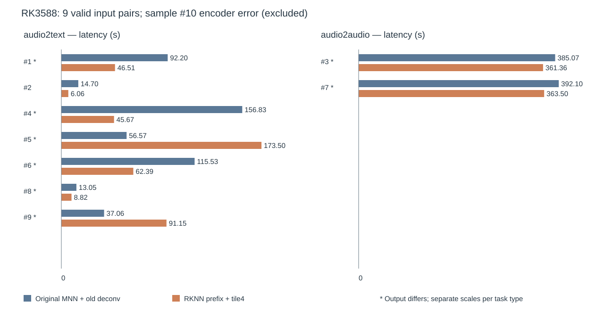

# Omni 组合路径：随机10条端到端 A/B

**组合未通过输出保持验收。** 10条样本均尝试完成并保留20条正式请求记录；其中9对音频编码有效，1对严格同输出、8对输出不同；第10条两侧音频编码失败。有效9对累计请求耗时从 **1263.105 → 1158.949秒（降低8.25%）**，这个数字只能描述两条系统路径的耗时差异，不能认定为同输出优化收益。

| 记录身份 | 内容 |
|---|---|
| Task / Candidate | `omni-combined-audio-route-e2e` / `rknn-prefix-bigvgan-tile4` |
| Run | `20261109-112115-omni-combined-e2e-random10` |
| old | 原 MNN/OpenCL 完整音频编码器 + 旧 ConvTranspose（tile0） |
| new | 既有 RKNN/NPU 音频前缀 + CPU 编码器尾部 + BigVGAN tile4 |
| 平台 | 原 RK3588，MNN 3.6.2 / Mali OpenCL / RKNN 2.3.2，裸机运行 |
| 评测边界 | 同模型源文件、同输入协议；音频后端数值路线不同；未执行质量评分 |

这里的 NPU 路径是既有 `Conv1 → GELU → Conv2 → GELU` 前缀，不是独立优化的 Conv2+GELU kernel。模型文件一致也不代表编码器浮点执行一致。本轮没有给两个改动分别计算贡献。



## 输入与计时方式

从完整 VCB-Bench 全类别的11,362条记录、63个 JSONL 中，用固定种子20261109不放回抽取10条，保留抽取顺序。抽样包含8条 audio2text、2条 audio2audio、3条多轮记录，共26个输入音频文件、172.354秒源音频。原问题与历史保持，答案参考与模型输入分开。

两个模型实例常驻、请求串行；每条只有一对正式 A/B，跨样本交替顺序。两侧各一次完整语音预热，排除在正式统计之外；其余动态 shape 首次使用成本仍计入。计时为宿主单调钟 response 开始至文本返回或语音生成完成，不含模型加载、预热和输出文件落盘。详细 profiling 与 capture 关闭。两侧开启 PreDiT 同步，保留 DiT FP32；文本上限均为1024。

## 全部正式配对

| 行 | 样本 | 类型 | old秒 | new秒 | old/new | 审查结果 |
|---:|---|---|---:|---:|---:|---|
| 1 | `zhuanzhe0124-3` | audio2text | 92.199 | 46.514 | 1.982× | 有效，输出不同 |
| 2 | `gk_law_02982` | audio2text | 14.699 | 6.055 | 2.428× | 有效，严格一致 |
| 3 | `en_teshuyinxiao_000060` | audio2audio | 385.068 | 361.363 | 1.066× | 有效，输出不同 |
| 4 | `topic_shift_neirong_000074` | audio2text | 156.827 | 45.673 | 3.434× | 有效，输出不同；old达1024上限 |
| 5 | `en_xuxie_000273` | audio2text | 56.566 | 173.496 | 0.326× | 有效，退化；new达1024上限 |
| 6 | `huisu0141-4` | audio2text | 115.535 | 62.386 | 1.852× | 有效，输出不同 |
| 7 | `yuyan_000986` | audio2audio | 392.102 | 363.500 | 1.079× | 有效，语音/波形不同 |
| 8 | `accent_dongbei_cmp_gongqing_000110` | audio2text | 13.053 | 8.816 | 1.481× | 有效，输出不同 |
| 9 | `zhuanzhe0263-1` | audio2text | 37.058 | 91.147 | 0.407× | 有效，退化；new达1024上限 |
| 10 | `dc_induction_conv0081_649_39` | audio2text | 11.387 | 11.745 | — | 两侧编码失败，时间不纳入有效比较 |

| 有效配对分组 | 对数 | old累计秒 | new累计秒 | 时间降低 |
|---|---:|---:|---:|---:|
| audio2text | 7 | 485.935600276 | 434.085837619 | 10.67% |
| audio2audio | 2 | 777.169523137 | 724.863235401 | 6.73% |
| 全部有效配对 | 9 | 1263.105123413 | 1158.949073020 | 8.246% |

唯一严格同输出子集是第2条，14.698678489 → 6.055010139秒；它不能推广至其他样本。第7条文本 token 数同为84，仍有语音 token/波形差异，波形相对 RMSE 为1.4460851583。第3条两侧波形长度不同，未裁剪或对齐后伪装一致。

## 为什么修正了原 runner 的“成功”

第10条两侧日志均出现：

```text
Broad cast error, dim1 = 1500, dim2 = 2251
Compute Shape Error for /Add_2_output_0
Media encoder returned no features
```

外层程序仍生成文本、退出0并写入 success。最终离线日志审查将该配对标为无效，保留原始状态与耗时，没有替换输入、裁剪音频或重跑。完整性检查通过，只表示记录完整；组合正确性没有通过。

## 能得到的结论与下一步

本轮保存了一个有价值的负例：局部 BigVGAN 对拍通过，无法保证后端迁移后的组合保持端到端输出。文本任务也产生差异，下一步应先检查音频前缀与 CPU tail 的边界/数值对齐，再做分离改动的消融。第5、9条的回退说明生成工作量变化会反转耗时，不能只展示加速样本。

每条只有一次配对，不报告显著性或稳定p95；未评估答案正确率、语义、听感、单实例内存或并发吞吐。这里是历史原板裸机结果，未验证 Docker 或第二台设备。后续建议见 [候选设计与决策](../../experiments/rknn-prefix-bigvgan-tile4/design.md)。

## 数据入口

- [归档说明与来源清单](../../benchmarks/history/20261109-omni-combined-random10/README.md)：原始配置、逐请求指标、输出文本、采样、日志、遥测和发布身份。
- [最终统计](../../benchmarks/history/20261109-omni-combined-random10/analysis/summary.json) · [逐样本CSV](../../benchmarks/history/20261109-omni-combined-random10/analysis/per_sample.csv) · [新旧答案](../../benchmarks/history/20261109-omni-combined-random10/analysis/answers.json)。
- [候选身份](../../experiments/rknn-prefix-bigvgan-tile4/candidate.json) · [精确测量runner](../../src/apps/omni_batch_ab.cpp) · [离线分析器](../../tools/analysis/analyze_combined.py)。

模型、输入音频、波形、二进制和完整 HTML 留在本地权威工具包归档；仓库保留小型文本、图表、资产身份及哈希。基于记录复算不等于重新读取外置波形验证，更不构成新的设备实验。
